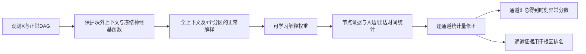

# Causal TSAD + RCA：因果时间统计量模型

这是从实验仓库 [CausalTSAD](https://github.com/ayumurephael/CausalTSAD) 独立整理出的单方法版本。主方法为 **`stat_temporal`：正常因果关系预测＋多尺度时间统计量＋视图内排序监督**。代码、三种子训练权重、正常基函数权重、原始结果、训练曲线、数据生成器与复现命令均保留。

**当前证据：32个来源确认系统上，AP 69.07%，条件根因Top‑1 64.58%。**这是本轮同数据、同口径比较中AP与条件Top‑1最高的条件；不能与不同数据范围的历史分支直接排名。它尚未在完整生成开发基准上完成迁移，也不是SOTA证明。

## 1. 这到底是什么模型

输入为多通道观测 `X[T,C]` 和正常DAG邻接矩阵 `G[C,C]`，其中 `G[parent, child]=1`。模型先从当前case的受保护上下文估计正常关系，再计算节点残差及边的时间统计量，输出每个时刻的异常分数和各通道的根因证据。

**这个版本不依赖TimeRCD推理，也不是在TimeRCD上新增一个根因头。**原实验同时跑了TimeRCD参照，但它的输出不参与本方法。测试时神经权重固定；case内有闭式回归估计，参考上下文不假定干净。它是离线检测器，可利用查询块之外的未来上下文，不能称在线检测。



选定版本只训练1,794个解释选择器/统计量头参数；正常基函数冻结。检测与定位使用同一组逐通道证据，定位没有独立root交叉熵监督。实验中的额外故障类型头表现更差，因此没有作为本仓库默认模型。

## 2. 已有结果与不能混淆的口径

64训练系统、16正常校准系统、32独立来源确认系统；通道数8/12/16/20，每系统16视图，长度1024，统一评估第32点起的完整后缀。三优化种子的指标先在系统内平均，统计样本量仍是32；**不是先平均三条预测曲线后算指标**。

| 同口径方法 | AP | 梯形PR-AUC | 正常FPR↓ | 条件根因Top‑1 | 检测后联合根因召回 |
|---|---:|---:|---:|---:|---:|
| 原观测→自训练TimeRCD | 55.49% | 55.20% | 0.79% | 不评 | 不评 |
| 单点因果证据 `full` | 60.63% | 59.71% | 1.11% | 55.47% | 42.19% |
| 固定节点多尺度扫描 | 67.26% | 66.48% | 1.95% | 58.07% | 44.01% |
| 仅配对监督 `stat_pair` | 67.47% | 66.66% | 1.20% | 63.54% | **47.22%** |
| 本仓库 `stat_temporal` | **69.07%** | **68.27%** | 1.26% | **64.58%** | 46.61% |

本方法的AP比同容量配对监督高1.597个百分点，系统配对95%区间[0.715,2.481]；比固定节点扫描高1.805个百分点，但区间[−0.852,4.356]跨0。它不是每个指标都最好：联合检测→定位召回略低于`stat_pair`，正常误报也非最低。

- AP衡量异常时间点排序，不是正确率；梯形PR-AUC也不是VUS-PR。
- 条件Top‑1先给模型真实故障窗口，因此64.58%不代表自动检测并成功定位的比例；后者在本来源协议下为46.61%。
- 本次来源表没有VUS-PR；不能从68.27%的PR-AUC改名得到VUS-PR。
- 三seed分别：AP69.45/68.46/69.29%，条件Top‑1 65.10/64.06/64.58%。默认演示seed348是固定选择，汇总结果仍保留全部三seed。

[完整结果与局限](docs/RESULTS.md) · [逐系统正反例](results/source_v1/paired_systems.md) · [原始汇总JSON](results/source_v1/summary.json) · [训练曲线和逐视图指标](results/source_v1/runs/)

## 3. 从哪里开始学代码

按下面顺序阅读；不需要翻几十个历史分支：

1. [方法说明](docs/METHOD.md)：正常解释、边统计和训练目标各起什么作用。
2. [components.py](proposals/improvement3/components.py)：严格限制正常预测器能读取的观测。
3. [evidence.py](proposals/improvement3/evidence.py)：节点能量、边证据和时间累积。
4. [models.py](proposals/improvement3/models.py)：重点看`CandidateMethod`的`stat_temporal`分支与`loss()`。
5. [model.py](causal_tsad/model.py)：只接收观测和图的便携推理接口。
6. [source_pipeline.py](scripts/source_pipeline.py)：生成、缓存、固定384步训练、来源评估。

数学模块从原科学快照逐字节复制，SHA在[origin.json](provenance/origin.json)。便携入口只移除本方法不使用的TimeRCD原始/拼接前向，不改变选定模型公式；[打包验证](docs/VALIDATION.md)说明实际验证范围。`reference/`保存旧实验入口和协议，供追溯，不是推荐执行入口。

## 4. 安装与快速检查

Python 3.10以上。训练和完整评估使用GPU；以下保存结果汇总不需要PyTorch：

```bash
git clone https://github.com/ayumurephael/Causal_TSAD_RCA.git
cd Causal_TSAD_RCA
python scripts/verify_results.py

# 在GPU服务器环境安装适合该服务器CUDA的PyTorch，然后安装其余依赖
python -m pip install -r requirements.txt
python tests/check_packaged_model.py --device cuda
```

最后一条只检查一个已有来源视图：新入口应与原保存分数最大误差小于1e−7，且改变旧TimeRCD缓存字段不影响本模型。它不是完整模型重评。

## 5. 用自己的序列推断

```python
import numpy as np
from causal_tsad.model import CausalTemporalStatistics

model = CausalTemporalStatistics(seed=348, device="cuda")
out = model.predict(observed_values, normal_dag)
scores = out["score"]              # 对应原序列32..T-1
nodes = out["root_evidence"]       # [T-32,C]，不是生成器真根标签
alarms = out["alarm"]              # 来源正常99分位固定阈值
```

`observed_values`为有限数值的二维数组，`normal_dag`为0/1且无环的source→target邻接矩阵，T至少256。没有labels/root/真实lag/系数/正常孪生输入。长序列暂按完整case计算，显存和闭式回归成本会增长；本次69.07%只验证长度1024，不能自动外推到任意长度或通道数。

也可提供只含`values`与`graph`的NPZ：

```bash
python scripts/predict.py --input example.npz --output runs/prediction.npz --device cuda
```

根因概率是通道证据softmax后的排名量，不是已校准的真实因果后验概率。窗口级定位应平均窗口内逐点通道概率，再排序，不能直接把每时刻argmax当原条件Top‑1协议。

## 6. 完整重现路径

[复现指南](docs/REPRODUCE.md)提供四层检查：保存指标重算、固定权重推断、统计量头重训、可选正常基函数从头训练。源码与约百KB权重位于Git；大文件位于[Release `source-v1`](https://github.com/ayumurephael/Causal_TSAD_RCA/releases/tag/source-v1)：

| 文件 | 用途 |
|---|---|
| `source_pool_v1.tar` | 本轮64/16/32系统原始数据与审计元数据 |
| `basis_parent_source_v1.tar` | 生成正常基函数预训练数据的原始父数据池 |
| `stat_temporal_scores_v1.zip` | 三seed初始/最终逐点检测与通道证据数组 |

每个文件大小和SHA见[release_assets.json](provenance/release_assets.json)。这不是原25亿训练集，也不是250M目标基准；没有打开或发布锁定150M。所有训练均禁止读取目标基准。

## 7. 已知局限

平滑背景下AP62.03%、条件Top‑1 46.70%，明显弱于普通背景76.11%/82.47%。单点故障AP从原单点因果读出的76.20%降到69.81%；最差正常系统FPR10.58%。来源根只从有父节点的通道采样，不能声称覆盖所有根因类型。固定checkpoint的换图诊断尚未纳入本发布版，不把分别训练的真错图差异冒称纯推断图效应。

## 8. 两个仓库的分工

**CausalTSAD**保存实验、消融和失败分支；**Causal_TSAD_RCA**仅接收用户明确指定晋升的完整方法。后续不自动把每个proposal推到这里。本次`source-v1`是来源验证通过的候选发布，目标迁移完成后才能更新相应结论。旧仓库、数据、权重和结果均保留。
